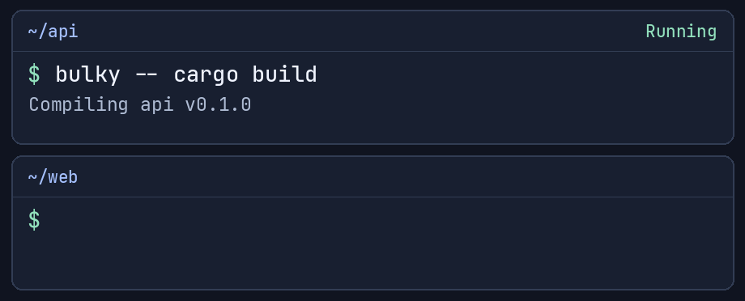

<h1 align="center">Bulky</h1>

<p align="center">Inspired by <a href="https://github.com/mokevnin/heavy">heavy</a> by <a href="https://github.com/mokevnin">@mokevnin</a>.</p>

<h3 align="center">Already building in another terminal?</h3>

<p align="center">Wrap your build and tests with <code>bulky --</code> to run one heavy command at a time.<br>
Even in a different project, the tests wait for the build to finish and then start automatically.</p>

<p align="center">
  <a href="https://crates.io/crates/bulky"></a>
  <a href="https://github.com/deyna256/bulky/actions/workflows/ci.yml"></a>
</p>

<p align="center">
  
</p>

## Quick start

Install on Linux, macOS or Windows with `cargo install --locked bulky`.

```sh
bulky -- cargo build     # In one terminal
bulky -- cargo test      # In another project, while the build runs
```

By default, **one wrapped command runs at a time** for your user account on this
machine. No daemon is required. Each command keeps its input, output and exit code.

```sh
bulky --status           # See which command holds each slot
bulky --set-limit 2      # Allow two workloads at once
```

<details>
<summary>How slots work</summary>

A slot covers one workload, including its threads and nested Bulky calls.
Bulky prints the holder's PID and program name once when it has to wait.
Any waiting command can take the next free slot.

The limit (1–256) is saved in `.bulky` in your home directory. Changes apply to
new and waiting commands. Bulky refuses to remove a busy slot.

The slot is released when the direct child exits. Force-killing Bulky also
releases it, even if the child keeps running.

</details>

Linux Mint also ships a file renamer named `bulky`. If you have both installed,
use the full path to the one you want.

[Contributing](https://github.com/deyna256/bulky/blob/main/CONTRIBUTING.md) ·
[Security policy](SECURITY.md) · [Apache-2.0 license](LICENSE)
